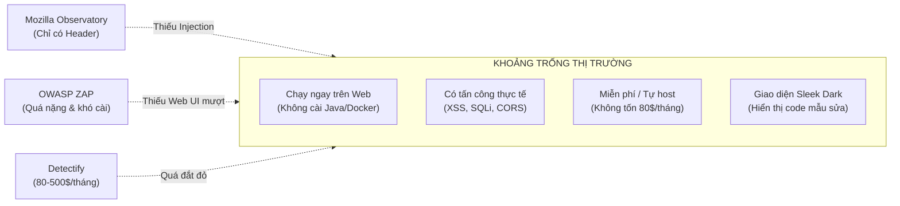

# 🧠 BRAINSTORMING.md — Nghiên Cứu Đối Thủ, Thị Trường & Định Hướng Phát Triển

> **Dự án**: OguriScan  
> **Mục tiêu tài liệu**: Phân tích toàn cảnh các giải pháp quét bảo mật web hiện có trên thế giới, tìm kiếm khoảng trống thị trường (Market Gap), và vạch ra lộ trình mở rộng sau này.

---

## 🏪 1. Toàn Cảnh Các Đối Thủ Trên Thị Trường (Competitor Landscape)

Trên Internet hiện nay, các công cụ quét an ninh web phân hóa thành 3 nhóm rõ rệt:

### Nhóm 1: Công cụ Kiểm tra Thụ động Miễn phí (Chỉ đọc Header / Cấu hình)

| Đối thủ | Địa chỉ | Điểm mạnh | Điểm yếu chí mạng |
|---|---|---|---|
| **Mozilla Observatory** | `observatory.mozilla.org` | Uy tín từ Mozilla, chấm điểm A–F dễ hiểu, kiểm tra tiêu đề HTTP và TLS cơ bản. | **Hoàn toàn thụ động**: Không kiểm tra lỗ hổng tấn công thực tế (không có XSS, SQLi, CORS reflection, rò rỉ mã bí mật trong JS). |
| **SecurityHeaders.com** | `securityheaders.com` | Rất nhanh, giao diện đơn giản, được cộng đồng dev trích dẫn nhiều. | Chỉ kiểm tra duy nhất tiêu đề HTTP response. Không kiểm tra cookie chuyên sâu, không quét mã nguồn. |
| **Qualys SSL Labs** | `ssllabs.com/ssltest` | Tiêu chuẩn vàng thế giới về phân tích mã hóa TLS/SSL, cực kỳ chi tiết. | Chỉ phục vụ một mục đích duy nhất là SSL; thời gian quét rất lâu (1–2 phút); không có bất kỳ bài kiểm tra ứng dụng web nào. |

---

### Nhóm 2: Công cụ DAST Mã Nguồn Mở (Yêu cầu Cài đặt Phức tạp)

| Đối thủ | Loại hình | Điểm mạnh | Điểm yếu chí mạng |
|---|---|---|---|
| **OWASP ZAP** | Phần mềm máy tính / Docker | Bộ công cụ chuẩn ngành bảo mật, cực kỳ mạnh mẽ, kiểm tra sâu cả ứng dụng và logic. | **Cực kỳ khó sử dụng cho developer thông thường**: Phải cài đặt Java/Docker, giao diện phức tạp như ma trận, cấu hình proxy rườm rà. |
| **Nuclei (ProjectDiscovery)** | Công cụ dòng lệnh (CLI) | Chạy rất nhanh, cộng đồng đóng góp mẫu YAML phát hiện CVE mới liên tục, ít báo động giả. | Thuần dòng lệnh (CLI), yêu cầu người dùng phải có chuyên môn DevOps/Security để chạy và đọc file log. |
| **Nikto** | CLI Scanner | Quét nhanh các tệp tin nguy hiểm và phiên bản máy chủ lỗi thời. | Công nghệ cũ, tỷ lệ báo động giả (false positive) rất cao, không hỗ trợ giao diện web. |

---

### Nhóm 3: Nền tảng SaaS Thương mại (Giá Rất Đắt)

| Đối thủ | Mức giá | Điểm mạnh | Điểm yếu chí mạng |
|---|---|---|---|
| **Detectify** | Từ **~82 € đến hơn 500 € / tháng** (~2–12 triệu VNĐ) | Nền tảng chuyên nghiệp, tích hợp dữ liệu từ cộng đồng hacker mũ trắng (crowdsourced), theo dõi liên tục. | **Quá đắt đối với cá nhân / startup nhỏ**: Bắt buộc đăng ký tài khoản doanh nghiệp, phải book lịch demo bán hàng. |
| **Pentest-Tools.com** | Từ **79 $ đến 399 $ / tháng** (~2–10 triệu VNĐ) | Đầy đủ tính năng DAST, quét XSS, SQLi, báo cáo PDF đẹp mắt. | Bắt buộc tạo tài khoản trả phí; gói miễn phí bị giới hạn rất ngặt nghèo (1–2 lần quét/ngày). |
| **HostedScan** | Từ **19 $ đến 99 $ / tháng** | Bản OWASP ZAP chạy trên nền web được đóng gói sẵn. | Bản chất vẫn là wrapper của ZAP, thời gian quét chậm, khả năng tùy biến thấp. |

---

## 🎯 2. Khoảng Trống Thị Trường Của OguriScan (Market Gap)

Từ bức tranh đối thủ trên, ta thấy rõ một **khoảng trống lớn chưa được giải quyết tốt**:
> **Thị trường đang thiếu một công cụ kết hợp được: Miễn phí + Chạy trực tiếp trên Web (không cần cài đặt) + Kiểm tra được các lỗ hổng tấn công thực tế (XSS, SQLi, CORS, Rò rỉ Secret) + Giao diện Dark Mode hiện đại, dễ hiểu cho Developer.**

### Các Tính Năng Độc Quyền Mà Đối Thủ Miễn Phí Không Có:
1. **Kiểm tra CORS Reflection kèm Credentials**: Hầu như không có công cụ online miễn phí nào giả lập Origin lạ để bắt lỗi cấu hình CORS nguy hiểm này.
2. **Quét Rò rỉ Khóa Bí mật trong file JavaScript tĩnh**: Tự động tải các file `.js` của website và quét biểu thức Regex tìm AWS Key, JWT, Stripe Secret, Google API Key.
3. **Phát hiện Nguy cơ Cướp Tên miền con (Subdomain Takeover)**: Kiểm tra các CNAME trỏ về dịch vụ đã bị xóa.
4. **Hướng dẫn Sửa lỗi Kèm Code Mẫu Trực quan**: Thay vì chỉ ném ra một dòng thông báo lỗi trừu tượng, OguriScan cung cấp đoạn code mẫu Trước / Sau khi sửa (Vulnerable vs Patched) giúp developer sửa xong ngay trong 5 phút.

---

## 📊 3. Bảng So Sánh Tính Năng Trực Tiếp

| Tính năng cốt lõi | Mozilla Observatory | SSL Labs | SecurityHeaders | OWASP ZAP | Detectify | **OguriScan** |
|---|:---:|:---:|:---:|:---:|:---:|:---:|
| **Không cần cài đặt (Chạy trên Web)** | ✅ | ✅ | ✅ | ❌ | ✅ | ✅ |
| **Miễn phí cho cá nhân** | ✅ | ✅ | ✅ | ✅ | ❌ | ✅ |
| **Kiểm tra Cookie (Secure, HttpOnly)** | ✅ | ❌ | ❌ | ✅ | ✅ | ✅ |
| **Kiểm tra Security Headers (CSP, HSTS)** | ✅ | ❌ | ✅ | ✅ | ✅ | ✅ |
| **Kiểm tra Chứng chỉ TLS/SSL** | ✅ | ✅ | ❌ | ✅ | ✅ | ✅ |
| **Kiểm tra Lỗ hổng CORS Misconfiguration** | ❌ | ❌ | ❌ | ✅ | ✅ | ✅ |
| **Dò tìm XSS Thực tế (Reflected)** | ❌ | ❌ | ❌ | ✅ | ✅ | ✅ |
| **Dò tìm SQL Injection (Error-based)** | ❌ | ❌ | ❌ | ✅ | ✅ | ✅ |
| **Quét Khóa Bí mật trong file JavaScript** | ❌ | ❌ | ❌ | ❌ | ✅ | ✅ |
| **Dò tìm Subdomain Takeover** | ❌ | ❌ | ❌ | ❌ | ✅ | ✅ |
| **Thời gian quét dưới 60 giây** | ✅ | ❌ | ✅ | ❌ | ❌ | ✅ |
| **Giao diện Sleek Dark Mode hiện đại** | ⚠️ | ⚠️ | ⚠️ | ❌ | ✅ | ✅ |
| **Lưu lịch sử quét (History)** | ❌ | ❌ | ❌ | ✅ | ✅ | ✅ |
| **Xuất báo cáo JSON / Bản in PDF** | ❌ | ✅ | ❌ | ✅ | ✅ | ✅ |

---

## 🚀 4. Ý Tưởng Mở Rộng Sau Này (Future Roadmap)

### Giai đoạn Mở rộng Tính năng Nâng cao (Phase 2 & 3)
1. **Tích hợp Trợ lý Trí tuệ Nhân tạo (AI Remediation)**:
   - Sử dụng Amazon Bedrock (Claude / Llama) để phân tích bối cảnh lỗi cụ thể của trang web và sinh đoạn mã vá lỗi được tối ưu riêng cho framework mà người dùng đang sử dụng.
2. **Lên Lịch Quét Tự Động Định Kỳ (Scheduled Scans)**:
   - Cho phép người dùng đăng ký tên miền để hệ thống tự động quét lại vào mỗi tuần/tháng (thông qua AWS EventBridge Scheduler).
   - Tự động gửi cảnh báo về Telegram hoặc Email khi phát hiện chứng chỉ SSL sắp hết hạn hoặc xuất hiện lỗi bảo mật mới.
3. **Tích hợp CI/CD Pipeline (GitHub Actions)**:
   - Phát hành một GitHub Action: `uses: oguri-lab/webscan-action@v1`.
   - Mỗi khi lập trình viên tạo Pull Request hoặc Deploy lên môi trường Staging, action tự động kích hoạt OguriScan. Nếu phát hiện lỗ hổng mức độ `CRITICAL` (như lộ AWS Key hoặc SQLi), PR sẽ bị chặn tự động để bảo vệ sản phẩm.
4. **Huy hiệu Bảo mật Trực quan (Security Score Badge)**:
   - Cho phép nhúng huy hiệu vào file `README.md` của dự án (tương tự Shields.io):
   - `https://webscan.oguri-lab.io.vn/badge/mysite.com.svg` ➔ Hiển thị huy hiệu `[OguriScan: Grade A]`.
5. **Cơ chế Quét Sau Đăng Nhập (Authenticated Scanning)**:
   - Cung cấp ô nhập cookie phiên hoặc header `Authorization: Bearer <token>` để kiểm tra các đường dẫn quản trị sau màn hình login.

---

## 💡 5. Định Hướng Khai Thác & Thương Mại Hóa (Nghiên cứu Tiềm năng)

Nếu dự án phát triển tốt và muốn chuyển đổi thành sản phẩm có nguồn thu:
- **Gói Miễn Phí (Community/Personal)**:
  - Cho phép quét tối đa 5 lượt / ngày.
  - Phù hợp cho cá nhân, sinh viên, lập trình viên độc lập kiểm tra website cá nhân.
- **Gói Nhà Phát Triển (Pro Plan - $5 đến $10 / tháng)**:
  - Quét không giới hạn lượt.
  - Tự động quét định kỳ hàng tuần kèm thông báo qua Telegram / Discord.
  - Tải báo cáo PDF chuyên nghiệp gắn logo thương hiệu riêng.
- **Mô hình Open Core (Mã nguồn mở động cơ)**:
  - Mở mã nguồn engine quét trên GitHub để xây dựng uy tín cá nhân và thu hút cộng đồng đóng góp.
  - Khai thác dịch vụ lưu trữ đám mây có sẵn (Cloud Hosted Service) trên tên miền `webscan.oguri-lab.io.vn`.
