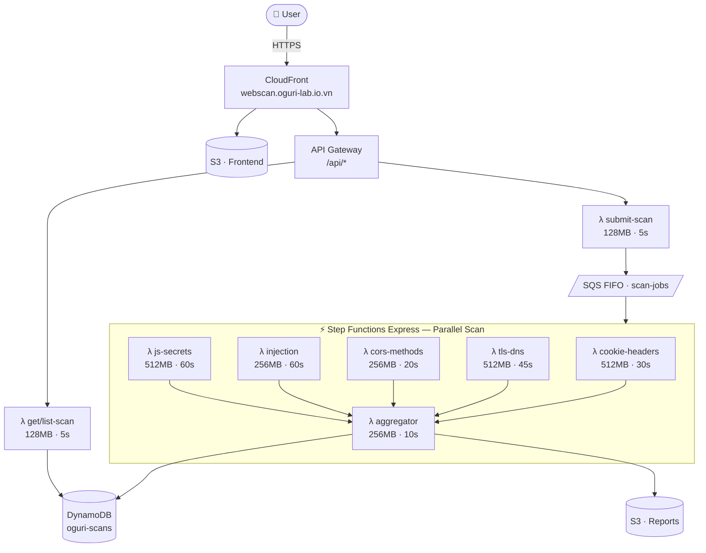
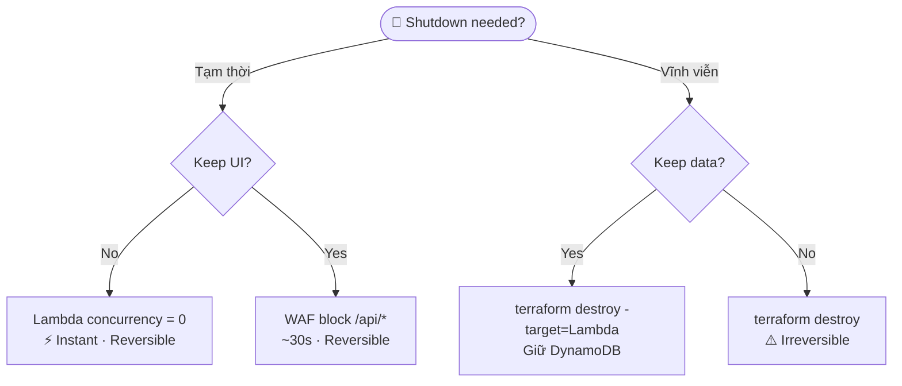

# 🚀 DEPLOY.md — OguriScan Infrastructure Guide

> **Project:** OguriScan — Web Security Scanner  
> **Domain:** `webscan.oguri-lab.io.vn`  
> **Stack:** Vite + React · Python Lambda (ZIP) · Terraform · AWS ap-southeast-1

---

## 📐 Architecture Overview



---

## 🌍 DNS & Domain Setup

Domain đã có: **oguri-lab.io.vn**

```
DNS Records (thêm vào DNS provider):

CNAME  webscan.oguri-lab.io.vn  →  d1234abcde.cloudfront.net
```

**AWS ACM Certificate** (phải dùng `us-east-1` cho CloudFront):
```bash
# Request cert ở us-east-1 (bắt buộc cho CloudFront)
aws acm request-certificate \
  --domain-name "webscan.oguri-lab.io.vn" \
  --validation-method DNS \
  --region us-east-1
```

---

## 🏗️ Tech Stack — Lightest for Deploy

### Frontend: Vite + React + Tailwind + shadcn/ui

```
Why Vite + React?
  ✅ Build output = pure static files (HTML/JS/CSS)
  ✅ Deploy to S3 = zero server cost
  ✅ shadcn/ui: copy-paste components, zero runtime overhead
  ✅ Tailwind: utility-first, tiny CSS bundle with purge

Build output: ~500KB gzipped (typical React SPA)
Deploy: aws s3 sync dist/ s3://oguri-scan-frontend
```

**Design System: shadcn/ui + Tailwind**
- Dark theme baked in (Vercel/Snyk aesthetic)
- Severity colors: `red-500` CRITICAL · `orange-400` HIGH · `yellow-300` MEDIUM · `blue-400` LOW · `gray-400` INFO
- Font: `Geist` (monospace for code) + `Inter` (body)

### Backend: Python 3.12 Lambda (ZIP)

```
Why Python?
  ✅ requests, dnspython, beautifulsoup4, sslyze — all có sẵn
  ✅ Lambda ZIP deploy dễ
  ✅ Lambda Layer cho shared dependencies

Dependencies per Lambda group:
  Layer 1 (shared): requests, boto3
  Layer 2 (heavy):  beautifulsoup4, dnspython, sslyze
  Lambda D:         requests (injection checks — no extra deps)
  Lambda E:         requests, beautifulsoup4, re (stdlib)
```

### IaC: Terraform

```
Why Terraform?
  ✅ Bạn đã quen dùng
  ✅ Destroy toàn bộ infra trong 1 lệnh: terraform destroy
  ✅ State file = audit trail của infra

Modules sẽ tạo:
  - aws_lambda_function × 9
  - aws_lambda_layer_version × 2
  - aws_sfn_state_machine × 1
  - aws_sqs_queue × 1
  - aws_dynamodb_table × 1
  - aws_s3_bucket × 2
  - aws_cloudfront_distribution × 1
  - aws_apigatewayv2_api × 1
  - aws_iam_role × multiple
```

---

## 📁 Project Structure

```
oguri-scan/
├── infra/                    # Terraform
│   ├── main.tf
│   ├── lambda.tf
│   ├── api_gateway.tf
│   ├── cloudfront.tf
│   ├── dynamodb.tf
│   ├── sqs.tf
│   ├── step_functions.tf
│   ├── variables.tf
│   └── outputs.tf
│
├── backend/                  # Python Lambda functions
│   ├── layers/
│   │   ├── shared/           # requests, boto3
│   │   └── heavy/            # bs4, dnspython, sslyze
│   ├── lambdas/
│   │   ├── submit_scan/
│   │   ├── cookie_headers/   # Group A
│   │   ├── tls_dns/          # Group B
│   │   ├── cors_methods/     # Group C
│   │   ├── injection/        # Group D
│   │   ├── js_secrets/       # Group E
│   │   ├── aggregator/
│   │   ├── get_scan/
│   │   └── list_scans/
│   └── shared/               # Common utilities
│       ├── models.py
│       └── severity.py
│
├── frontend/                 # Vite + React
│   ├── src/
│   │   ├── components/
│   │   │   ├── ScanForm.tsx
│   │   │   ├── ScanResults.tsx
│   │   │   ├── FindingCard.tsx
│   │   │   ├── ScoreGauge.tsx
│   │   │   └── SeverityBadge.tsx
│   │   ├── pages/
│   │   │   ├── Home.tsx
│   │   │   ├── ScanDetail.tsx
│   │   │   └── History.tsx
│   │   └── lib/
│   │       └── api.ts
│   ├── package.json
│   └── vite.config.ts
│
├── local/                    # Local development (no AWS)
│   ├── server.py             # FastAPI local server
│   ├── mock_aws.py           # Mock SQS/DynamoDB locally
│   └── run_local.sh
│
└── scripts/
    ├── deploy.sh             # Full deploy
    ├── deploy_frontend.sh    # Frontend only
    ├── deploy_lambda.sh      # Lambda only
    └── EMERGENCY_SHUTDOWN.sh # Kill switch
```

---

## 💰 Cost Analysis (ap-southeast-1, không AI)

### AWS Pricing ap-southeast-1 (Singapore)

```
Lambda compute:    $0.0000166667 / GB-second  (same as us-east-1)
Lambda requests:   $0.0000002    / invocation
API Gateway HTTP:  $1.00         / 1M requests
DynamoDB on-demand:$1.4375       / 1M WRU  (slightly higher than us-east-1)
S3 storage:        $0.025        / GB-month
CloudFront:        $0.12         / GB transfer (higher than us-east-1 $0.085)
SQS:               $0.40         / 1M requests
Step Functions:    $1.00         / 1M executions (Express)
```

### Per Scan Cost

| Component | Details | Cost |
|---|---|---|
| Lambda A (Cookie+Headers) | 512MB × 30s = 15 GB-s | $0.000250 |
| Lambda B (TLS+DNS) | 512MB × 45s = 22.5 GB-s | $0.000375 |
| Lambda C (CORS) | 256MB × 20s = 5.1 GB-s | $0.000085 |
| Lambda D (Injection) | 256MB × 60s = 15.4 GB-s | $0.000257 |
| Lambda E (JS Secrets) | 512MB × 60s = 30.7 GB-s | $0.000512 |
| Orchestrator + Aggregator | 128MB × 5s × 2 + 256MB × 10s | $0.000064 |
| Step Functions Express | 1 execution | $0.000001 |
| SQS | ~10 messages | $0.000004 |
| DynamoDB | ~50 WRU + ~20 RRU | $0.000079 |
| API Gateway | ~5 requests | $0.000005 |
| **TOTAL** | | **$0.0017 / scan** |

### Monthly Scenarios

| Scenario | Scans | Lambda GB-s | Cost/month |
|---|---|---|---|
| **Cá nhân** | 100 | 8,870 | **~$1/month** (within free tier) |
| **Dùng nhiều** | 500 | 44,350 | **~$1.50/month** (still free tier) |
| **1K scans** | 1,000 | 88,700 | **~$2/month** |
| **10K scans** | 10,000 | 887,000 | **~$12/month** |
| **100K scans** | 100,000 | 8,870,000 | **~$120/month** |

> **Free Tier coverage:** 400,000 GB-seconds/month → covers ~4,500 full scans/month FREE

### Fixed Monthly Costs

| Service | Cost |
|---|---|
| S3 (2 buckets, ~1GB) | ~$0.03 |
| CloudFront (1GB transfer) | ~$0.12 |
| DynamoDB (25GB free tier) | $0 |
| **Total Fixed** | **~$0.15/month** |

---

## ⚡ Capacity Planning

```
Lambda concurrency limit (default): 1,000
Lambda slots per scan (peak):       5 (parallel Tier 1 Lambdas)
Max simultaneous scans:             1,000 / 5 = 200 scans
Scan duration (wall time):          ~60 seconds
Throughput:                         200 × (3600/60) = 12,000 scans/hour

Burst handling: SQS queue (unlimited depth)
If 500 scans submitted simultaneously:
  → Batch 1: 200 scans processed (~60s)
  → Batch 2: 200 scans (~120s total)
  → Batch 3: 100 scans (~180s total)
  → All 500 done in ~3 minutes
```

---

## 🖥️ Local Development (No AWS Required)

```bash
# Backend — FastAPI local server
cd local/
pip install fastapi uvicorn requests beautifulsoup4 dnspython
python server.py
# → http://localhost:8000

# Frontend — Vite dev server
cd frontend/
npm install
npm run dev
# → http://localhost:5173
# VITE_API_URL=http://localhost:8000
```

**Local mode** chạy scan trực tiếp trong FastAPI process — không cần SQS/Step Functions/DynamoDB. Kết quả trả về synchronous, lưu in-memory hoặc SQLite local.

```python
# local/server.py — simplified
from fastapi import FastAPI
from scanner import run_all_checks  # Gọi trực tiếp, không qua Lambda

app = FastAPI()

@app.post("/api/scans")
async def submit_scan(body: ScanRequest):
    results = await run_all_checks(body.url)  # Run locally
    return results
```

---

## 🏗️ Deploy Commands

### First Time Setup

```bash
# 1. Build Lambda layers
cd backend/layers/shared && pip install -r requirements.txt -t python/
cd backend/layers/heavy && pip install -r requirements.txt -t python/

# 2. Terraform init + apply
cd infra/
terraform init
terraform plan
terraform apply

# 3. Build + deploy frontend
cd frontend/
npm run build
aws s3 sync dist/ s3://$(terraform output -raw frontend_bucket) --delete
aws cloudfront create-invalidation --distribution-id $(terraform output -raw cf_distribution_id) --paths "/*"
```

### Update Lambda Code

```bash
# Deploy single Lambda
cd backend/lambdas/injection/
zip -r function.zip .
aws lambda update-function-code \
  --function-name oguri-scan-injection \
  --zip-file fileb://function.zip \
  --region ap-southeast-1
```

### Update Frontend Only

```bash
./scripts/deploy_frontend.sh
# → npm build + s3 sync + CloudFront invalidation
```

---

## 🔴 Emergency Shutdown — Kill Switch

> Ngừng toàn bộ traffic ngay lập tức mà không destroy infra.

### Option 1: CloudFront Geographic Block (30s to effect)
```bash
# Tạo CloudFront distribution với custom error response
aws cloudfront update-distribution \
  --id $CF_DISTRIBUTION_ID \
  --default-root-object maintenance.html

# Hoặc dùng WAF rule chặn tất cả traffic
aws wafv2 update-web-acl \
  --scope CLOUDFRONT \
  --id $WAF_ACL_ID \
  --default-action Block={}
```

### Option 2: API Gateway — Disable Stage (Instant)
```bash
# Disable toàn bộ API Gateway stage
aws apigatewayv2 update-stage \
  --api-id $API_ID \
  --stage-name prod \
  --throttling-burst-limit 0 \
  --throttling-rate-limit 0

# → Tất cả request nhận 429 Too Many Requests ngay lập tức
```

### Option 3: Lambda Concurrency = 0 (Instant, recommended)
```bash
#!/bin/bash
# scripts/EMERGENCY_SHUTDOWN.sh
FUNCTIONS=(
  "oguri-scan-submit"
  "oguri-scan-cookie-headers"
  "oguri-scan-tls-dns"
  "oguri-scan-cors"
  "oguri-scan-injection"
  "oguri-scan-js-secrets"
  "oguri-scan-aggregator"
  "oguri-scan-get-scan"
  "oguri-scan-list-scans"
)

for fn in "${FUNCTIONS[@]}"; do
  echo "⛔ Throttling $fn..."
  aws lambda put-function-concurrency \
    --function-name "$fn" \
    --reserved-concurrent-executions 0 \
    --region ap-southeast-1
done

echo "✅ All Lambda functions throttled. Tool is offline."
echo "   API calls will return 429 immediately."
echo ""
echo "To restore: run ./scripts/RESTORE.sh"
```

```bash
#!/bin/bash
# scripts/RESTORE.sh
FUNCTIONS=(...)
for fn in "${FUNCTIONS[@]}"; do
  aws lambda delete-function-concurrency \
    --function-name "$fn" \
    --region ap-southeast-1
done
echo "✅ Tool restored. All functions back online."
```

### Option 4: Full Destroy (Permanent)
```bash
# ⚠️ WARNING: Xóa toàn bộ infra, data, không phục hồi được
cd infra/
terraform destroy
```

### Shutdown Decision Tree



---

## 📊 Terraform State Management

```hcl
# infra/backend.tf
terraform {
  backend "s3" {
    bucket = "oguri-terraform-state"
    key    = "oguri-scan/terraform.tfstate"
    region = "ap-southeast-1"
    
    # Locking với DynamoDB (optional nhưng recommended)
    dynamodb_table = "terraform-locks"
    encrypt        = true
  }
}
```

```bash
# Xem resources đang có
terraform state list

# Import existing resource vào state
terraform import aws_lambda_function.submit_scan oguri-scan-submit

# Xem plan trước khi apply
terraform plan -out=plan.tfplan
terraform apply plan.tfplan
```

---

## 🔐 IAM Permissions (Principle of Least Privilege)

```hcl
# Mỗi Lambda có role riêng, chỉ có quyền cần thiết

# Lambda D (Injection) — chỉ cần đọc/ghi DynamoDB
resource "aws_iam_role_policy" "injection_policy" {
  name = "injection-minimal"
  role = aws_iam_role.injection_role.id
  policy = jsonencode({
    Statement = [{
      Effect = "Allow"
      Action = [
        "dynamodb:PutItem",
        "dynamodb:UpdateItem"
      ]
      Resource = aws_dynamodb_table.scans.arn
    }]
  })
}

# Lambda submit — cần ghi SQS + Step Functions
# Lambda get_scan — chỉ cần đọc DynamoDB
```

---

## 📈 Monitoring

```bash
# Xem Lambda errors
aws logs filter-log-events \
  --log-group-name "/aws/lambda/oguri-scan-injection" \
  --filter-pattern "ERROR" \
  --start-time $(date -d '1 hour ago' +%s)000

# Xem scan throughput
aws cloudwatch get-metric-statistics \
  --namespace AWS/Lambda \
  --metric-name Invocations \
  --dimensions Name=FunctionName,Value=oguri-scan-injection \
  --start-time $(date -u -d '24 hours ago' +%Y-%m-%dT%H:%M:%SZ) \
  --end-time $(date -u +%Y-%m-%dT%H:%M:%SZ) \
  --period 3600 \
  --statistics Sum
```

---

## 🗓️ Deploy Checklist

```
First Deploy:
[ ] AWS CLI configured (ap-southeast-1)
[ ] Terraform installed
[ ] Node.js 18+ installed
[ ] Python 3.12 installed

[ ] Create S3 bucket for Terraform state
[ ] terraform init && terraform apply
[ ] Build Lambda layers (pip install)
[ ] Deploy Lambda ZIPs
[ ] Build frontend (npm run build)
[ ] Sync frontend to S3
[ ] Request ACM certificate (us-east-1!)
[ ] Add CNAME DNS record: webscan.oguri-lab.io.vn → CloudFront
[ ] Test: curl https://webscan.oguri-lab.io.vn/api/health
[ ] Test: submit scan for https://example.com

Ongoing:
[ ] Check CloudWatch for errors weekly
[ ] Monitor DynamoDB capacity monthly
[ ] Review costs in AWS Cost Explorer monthly
```
