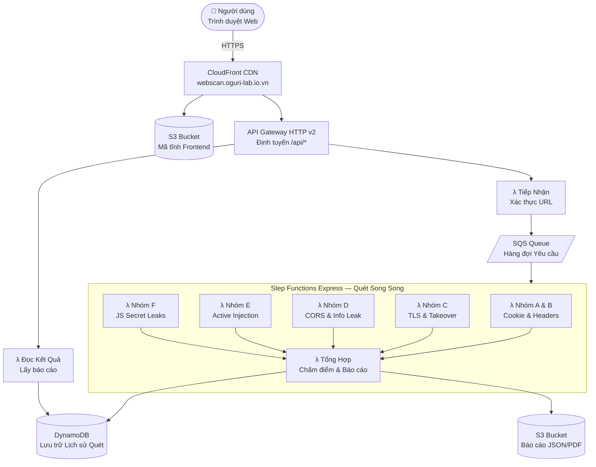
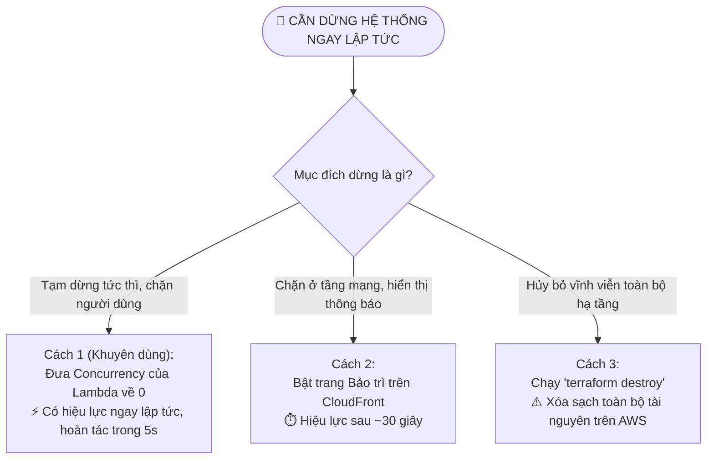

# 🚀 DEPLOY.md — Hướng Dẫn Hạ Tầng & Triển Khai AWS Serverless

> **Dự án**: OguriScan — Công cụ Quét Bảo mật Web Động (DAST)  
> **Tên miền**: `webscan.oguri-lab.io.vn`  
> **Khu vực AWS**: `ap-southeast-1` (Singapore — tối ưu độ trễ cho Việt Nam)  
> **Công nghệ Hạ tầng**: Terraform · CloudFront · S3 · API Gateway · AWS Lambda (ZIP) · DynamoDB  

---

## 📐 1. Sơ Đồ Kiến Trúc Hệ Thống (Architecture Diagram)

Kiến trúc Serverless hoàn toàn không dùng máy chủ vật lý, tối ưu chi phí và tự động co giãn theo nhu cầu:



---

## 🌐 2. Thiết Lập Tên Miền & Chứng Chỉ SSL

Tên miền sẵn có của bạn: **oguri-lab.io.vn**  
Subdomain phân bổ cho dịch vụ: **`webscan.oguri-lab.io.vn`**

### Bước A: Tạo Chứng Chỉ SSL/TLS trên AWS ACM
> **LƯU Ý QUAN TRỌNG**: Để gắn chứng chỉ SSL vào CloudFront, bạn **BẮT BUỘC** phải tạo chứng chỉ tại vùng **`us-east-1` (N. Virginia)** (quy định kỹ thuật của AWS CloudFront), mặc dù toàn bộ backend Lambda đặt ở Singapore `ap-southeast-1`.

```bash
# Yêu cầu cấp chứng chỉ miễn phí từ AWS ACM
aws acm request-certificate \
  --domain-name "webscan.oguri-lab.io.vn" \
  --validation-method DNS \
  --region us-east-1
```
Sau đó, vào trang quản lý DNS của nhà cung cấp tên miền của bạn, thêm bản ghi CNAME xác thực theo giá trị mà AWS ACM cung cấp.

### Bước B: Trỏ DNS Tên Miền về CloudFront
Sau khi triển khai CloudFront qua Terraform, bạn sẽ nhận được địa chỉ phân phối (ví dụ: `d12345abcdef.cloudfront.net`).  
Thêm bản ghi sau vào hệ thống quản lý DNS của tên miền `oguri-lab.io.vn`:
```
Loại bản ghi: CNAME
Tên (Host):   webscan
Giá trị:      d12345abcdef.cloudfront.net
TTL:          300 (hoặc Tự động)
```

---

## 📦 3. Tech Stack Nhẹ Nhất Cho Quá Trình Triển Khai

| Thành phần | Lựa chọn Công nghệ | Lý do Tối ưu Chi phí & Tốc độ |
|---|---|---|
| **Frontend** | **Vite + React (TypeScript)** | Bản build sinh ra 100% tệp tĩnh (HTML/JS/CSS, dung lượng nén < 500KB). Lưu trữ trực tiếp trên S3 + phân phối qua CloudFront, **chi phí server = 0 đồng**. |
| **Giao diện** | **TailwindCSS + shadcn/ui** | Không có thư viện runtime nặng nề. Code component nằm trực tiếp trong source code, loại bỏ CSS thừa khi build. |
| **Backend** | **Python 3.12 Lambda (ZIP)** | Sử dụng thư viện chuẩn và gói nén ZIP (< 20MB). Không cần dùng Docker container cồng kềnh, khởi động nhanh (cold start < 1 giây). |
| **Cơ sở Dữ liệu** | **Amazon DynamoDB (On-Demand)** | Cơ sở dữ liệu NoSQL Serverless. Chỉ tính tiền trên mỗi lần đọc/ghi thực tế; miễn phí 25GB lưu trữ đầu tiên mỗi tháng. |
| **Hạ tầng (IaC)** | **Terraform** | Quản lý toàn bộ tài nguyên bằng mã nguồn mở, dễ dàng hủy toàn bộ hệ thống bằng 1 câu lệnh khi không dùng nữa. |

---

## 📁 4. Cấu Trúc Thư Mục Dự Án Chuẩn

```
webscan/
├── .agents/
│   └── skills/                   # Skills đã được cài đặt cho Agent
│       ├── shadcn/               # Thư viện UI shadcn/ui & Radix
│       ├── vercel-composition-patterns/ # Chuẩn composition patterns của Vercel
│       ├── web-design-guidelines/       # Quy chuẩn thiết kế UX, Accessibility
│       └── developer-workflow/          # Quy chuẩn Unit Test & Git Commit message format
├── backend/                      # Python backend (Engine quét & API)
│   ├── scanner/                  # Lõi thực thi các bài kiểm tra bảo mật
│   │   ├── crawler.py            # Thu thập URL/param có kiểm soát (Safety limits)
│   │   ├── group_cookies_headers.py # Quét Cookies & Security Headers
│   │   ├── group_tls_dns.py      # Quét TLS/SSL & Subdomain Takeover
│   │   ├── group_cors.py         # Quét cấu hình sai CORS
│   │   ├── group_injection.py    # Quét XSS, SQLi, Open Redirect, Path Traversal
│   │   └── group_js_secrets.py   # Quét rò rỉ khóa bí mật trong file JS
│   ├── core/                     # Cấu hình, timeouts, circuit breaker
│   ├── local_server.py           # FastAPI local server
│   └── lambda_handler.py         # AWS Lambda entrypoint cho deploy sau này
├── frontend/                     # Giao diện người dùng (Vite + React + TS)
│   ├── src/
│   │   ├── components/           # UI components tuân thủ shadcn & Vercel patterns
│   │   ├── lib/                  # Utilities, storage, API client
│   │   └── App.tsx
│   ├── package.json
│   └── vite.config.ts
├── infra/                        # Hạ tầng đám mây (Terraform)
│   ├── main.tf
│   ├── lambda.tf
│   └── variables.tf
├── .gitignore
├── AGENTS.md                     # Tài liệu quy ước cho AI Agents
├── BRAINSTORMING.md              # Phân tích đối thủ & định hướng thị trường
├── DEPLOY.md                     # Hướng dẫn hạ tầng, chi phí & cơ chế dừng khẩn cấp
├── PROJECT.md                    # Bản đặc tả kỹ thuật chi tiết các bài kiểm tra
└── README.md
```

---

## 💰 5. Bảng Dự Toán Chi Phí Hạ Tầng (AWS Singapore ap-southeast-1)

Hệ thống được thiết kế theo mô hình **Pay-as-you-go (Chỉ trả tiền khi có lượt quét thực tế)**, không phát sinh chi phí duy trì cố định hàng tháng nếu không có người dùng.

### Chi phí cho 1 Lượt Quét Đầy Đủ (Single Scan Cost)
Mỗi lượt quét kích hoạt 5 hàm Lambda chạy song song trong trung bình 30–45 giây:

| Dịch vụ AWS | Mức sử dụng ước tính | Đơn giá AWS Singapore | Thành tiền (USD) |
|---|---|---|---|
| **AWS Lambda Compute** | ~60 GB-giây (Bộ nhớ 256MB–512MB) | $0.0000166667 / GB-giây | **$0.00100** |
| **AWS Lambda Invocations**| 7 lần gọi hàm | $0.20 / 1.000.000 lượt | **$0.000001** |
| **API Gateway HTTP** | ~5 yêu cầu HTTP | $1.00 / 1.000.000 yêu cầu | **$0.000005** |
| **Amazon DynamoDB** | 10 lần ghi + 5 lần đọc | $1.4375 / 1.000.000 WRU | **$0.000021** |
| **Amazon S3 & CloudFront**| ~2 MB băng thông truyền tải | $0.12 / GB truyền tải | **$0.00024** |
| **TỔNG CỘNG CHO 1 LƯỢT QUÉT**| | | **~$0.0013 USD** (~32 đồng VN) |

### Chi Phí Ước Tính Theo Tháng Ở Các Quy Mô

| Kịch bản Sử dụng | Số lượt quét / tháng | Chi phí phát sinh thực tế | Đánh giá |
|---|---|---|---|
| **Cá nhân tự dùng** | 100 – 500 lượt | **0 USD** (Hoàn toàn MIỄN PHÍ) | Nằm trọn trong gói miễn phí AWS Free Tier (400.000 GB-giây Lambda/tháng). |
| **Team nhỏ / Thử nghiệm** | 1.000 lượt | **< 1 USD / tháng** | Tiết kiệm tối đa, chi phí gần như bằng không. |
| **Sản phẩm mở rộng (SaaS)** | 10.000 lượt | **~$13 USD / tháng** (~320.000 VNĐ) | Phục vụ 10.000 lượt quét chuyên sâu với chi phí cực thấp. |
| **Tải lớn** | 50.000 lượt | **~$65 USD / tháng** | Không lo sập server nhờ kiến trúc tự co giãn. |

---

## 🛑 6. Cơ Chế Tắt Khẩn Cấp (Emergency Shutdown / Kill Switch)

Khi phát hiện có kẻ gian lạm dụng công cụ (spam request, tấn công quá mức) hoặc muốn dừng dịch vụ ngay lập tức để không phát sinh chi phí, bạn có thể sử dụng các phương án sau:



### Cách 1 (Khuyên Dùng): Đưa Concurrency Của Lambda Về 0 (Hiệu lực trong 1 giây)
Đây là cách an toàn và nhanh nhất. Nó khóa toàn bộ khả năng thực thi của các hàm Lambda mà không làm mất cấu hình hay cơ sở dữ liệu. Mọi yêu cầu từ người dùng sẽ lập tức nhận mã phản hồi lỗi `429 Too Many Requests`.

Chạy script sau trong terminal:
```bash
#!/bin/bash
# Script tắt khẩn cấp: scripts/shutdown.sh
FUNCTIONS=(
  "oguri-scan-submit"
  "oguri-scan-cookies-headers"
  "oguri-scan-tls-dns"
  "oguri-scan-cors"
  "oguri-scan-injection"
  "oguri-scan-js-secrets"
  "oguri-scan-aggregator"
)

for fn in "${FUNCTIONS[@]}"; do
  echo "⛔ Đang khóa hàm: $fn..."
  aws lambda put-function-concurrency \
    --function-name "$fn" \
    --reserved-concurrent-executions 0 \
    --region ap-southeast-1
done

echo "✅ ĐÃ KHÓA TOÀN BỘ HỆ THỐNG. Không một request nào có thể thực thi."
```

Để khôi phục lại hoạt động bình thường:
```bash
# Script mở khóa: scripts/restore.sh
for fn in "${FUNCTIONS[@]}"; do
  aws lambda delete-function-concurrency \
    --function-name "$fn" \
    --region ap-southeast-1
done
echo "✅ ĐÃ KHÔI PHỤC HOẠT ĐỘNG TOÀN BỘ DỊCH VỤ."
```

### Cách 2: Khóa Ở Tầng API Gateway (Chặn lưu lượng vào Backend)
Đặt giới hạn tỷ lệ (throttling) của Stage trên API Gateway về 0:
```bash
aws apigatewayv2 update-stage \
  --api-id <API_ID> \
  --stage-name prod \
  --throttling-burst-limit 0 \
  --throttling-rate-limit 0 \
  --region ap-southeast-1
```

### Cách 3: Hủy Diệt Toàn Bộ Hạ Tầng (Permanent Teardown)
Khi không còn nhu cầu sử dụng dự án trên đám mây:
```bash
cd infra/
terraform destroy -auto-approve
```
Toàn bộ tài nguyên trên AWS (CloudFront, API Gateway, Lambda, S3, DynamoDB) sẽ được xóa sạch 100%, đảm bảo không phát sinh bất kỳ một xu nào.

---

## 🛠️ 7. Quy Trình Quản Lý Hạ Tầng Bằng Terraform

### Cấu hình Khởi tạo (First-time Deployment)
```bash
# 1. Di chuyển vào thư mục hạ tầng
cd infra/

# 2. Khởi tạo Terraform provider
terraform init

# 3. Xem trước các tài nguyên sẽ được tạo
terraform plan

# 4. Triển khai lên AWS
terraform apply
```

### Cập nhật Code Frontend Lên S3 & CloudFront
```bash
# 1. Build mã nguồn React
cd frontend/
npm run build

# 2. Đồng bộ tệp lên S3
aws s3 sync dist/ s3://oguri-scan-frontend-bucket/ --delete

# 3. Xóa bộ nhớ đệm CloudFront để cập nhật bản mới ngay lập tức
aws cloudfront create-invalidation \
  --distribution-id <DISTRIBUTION_ID> \
  --paths "/*"
```
