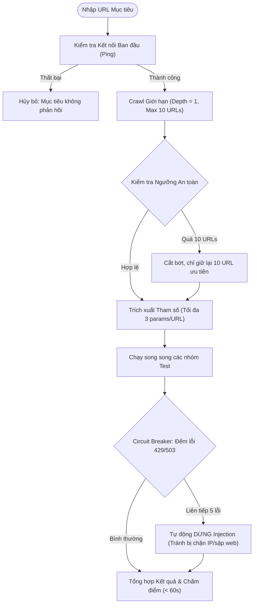

# 📋 PROJECT.md — Bản Đặc Tả Kỹ Thuật Dự Án OguriScan

> **Dự án**: OguriScan — Công cụ Đánh giá & Phát hiện Lỗ hổng Bảo mật Web (DAST)  
> **Trạng thái**: Kế hoạch chi tiết ➔ Phát triển Local  
> **Tên miền dự kiến**: `webscan.oguri-lab.io.vn`  
> **Công nghệ**: Vite + React (TypeScript) · Python 3.12 (FastAPI / Lambda) · Terraform · AWS ap-southeast-1  

---

## 🎯 1. Mục tiêu Dự án

Xây dựng một công cụ kiểm thử bảo mật động (DAST) chạy trực tiếp trên nền web, **không cần cài đặt phần mềm**. Người dùng chỉ cần dán URL trang web của mình, hệ thống sẽ thực hiện kiểm tra tự động toàn diện và trả về báo cáo chi tiết trong vòng **dưới 60 giây**.

### Nguyên tắc Lọc Bài Kiểm Tra (Loại bỏ kiểm tra thừa)
- ❌ **Loại bỏ kiểm tra lý thuyết / không gây hại trực tiếp**: Bỏ các mục cấu hình mang tính khuyến nghị hình thức như bản ghi CAA, thứ hạng HSTS preload, HTTP OPTIONS, v.v.
- ❌ **Loại bỏ SSRF**: Đã loại bỏ hoàn toàn do độ phức tạp cao, đòi hỏi hạ tầng callback bên ngoài phức tạp và dễ gây nghẽn tài nguyên.
- ✅ **Chỉ giữ lại các lỗ hổng có thể trực tiếp xâm nhập hoặc đánh cắp dữ liệu (Exploitable)**:
  - Chiếm phiên đăng nhập (Session Hijacking qua Cookie).
  - Tấn công giao diện (Clickjacking).
  - Rò rỉ thông tin đăng nhập / khóa bí mật (Secret Leaks trong mã nguồn JavaScript).
  - Đánh cắp dữ liệu qua trình duyệt (CORS Misconfiguration).
  - Thực thi mã độc trên trình duyệt nạn nhân (Reflected XSS).
  - Đọc / phá hoại cơ sở dữ liệu máy chủ (SQL Injection).
  - Lừa đảo chiếm tài khoản (Open Redirect).
  - Đọc tệp nhạy cảm trên máy chủ (Path Traversal / Local File Inclusion).
  - Cướp tên miền phụ (Subdomain Takeover).

---

## 🛡️ 2. Danh mục Các Bài Kiểm Tra Bảo Mật Trọng Tâm

Tổng hợp **28 bài kiểm tra thực chiến**, chia thành 5 nhóm logic:

```
┌────────────────────────────────────────────────────────────────────────┐
│                        TỔNG HỢP 28 BÀI KIỂM TRA THỰC CHIẾN             │
├────────────────────────────────┬───────────────────────────────────────┤
│ Nhóm A: Cookie & Phiên làm việc│ 5 bài (Secure, HttpOnly, SameSite,...)│
│ Nhóm B: Tiêu đề Chống Tấn công │ 5 bài (CSP, X-Frame-Options, HSTS,...)│
│ Nhóm C: Mã hóa & Tên miền phụ  │ 4 bài (TLS hết hạn, TLS cũ, CNAME)    │
│ Nhóm D: CORS & Rò rỉ Nhạy cảm  │ 5 bài (CORS reflection, Lộ mã lỗi)    │
│ Nhóm E: Tấn công Tiêm mã độc   │ 5 bài (XSS, SQLi, Open Redirect, LFI) │
│ Nhóm F: Rò rỉ Khóa trong JS    │ 4 bài (AWS Key, JWT, Stripe, Private) │
└────────────────────────────────┴───────────────────────────────────────┘
```

---

### Nhóm A: Bảo vệ Cookie & Phiên Làm Việc (Session Security)
*Mục đích: Ngăn chặn kẻ tấn công đánh cắp cookie đăng nhập của người dùng.*

| Mã | Tên bài kiểm tra | Nguy cơ nếu bị khai thác | Mức độ |
|---|---|---|---|
| **A1** | **Thiếu cờ `HttpOnly`** | Mã độc JavaScript (qua XSS) có thể đọc trực tiếp `document.cookie` và gửi về máy chủ của hacker để chiếm tài khoản. | 🔴 NGHIÊM TRỌNG |
| **A2** | **Thiếu cờ `Secure`** | Cookie được truyền qua giao thức HTTP không mã hóa nếu người dùng vô tình truy cập mạng WiFi công cộng (MITM). | 🔴 NGHIÊM TRỌNG |
| **A3** | **Thiếu hoặc sai cờ `SameSite`** | Trình duyệt tự động gửi cookie khi có yêu cầu từ trang web khác, mở đường cho tấn công Giả mạo yêu cầu (CSRF). | 🟠 CAO |
| **A4** | **Phạm vi Domain cookie quá rộng** | Cấu hình `Domain=.example.com` khiến tất cả tên miền con (kể cả subdomain không bảo mật) đều đọc được cookie. | 🟡 TRUNG BÌNH |
| **A5** | **Cookie đặt trước khi chuyển hướng HTTPS** | Trang HTTP ban đầu đã cấp cookie trước khi chuyển hướng sang HTTPS, làm lộ phiên làm việc ngay từ đầu. | 🟠 CAO |

---

### Nhóm B: Tiêu đề Trực tiếp Chống Tấn công (Security Headers)
*Mục đích: Kích hoạt các cơ chế tự bảo vệ có sẵn trên trình duyệt hiện đại.*

| Mã | Tên bài kiểm tra | Nguy cơ nếu bị khai thác | Mức độ |
|---|---|---|---|
| **B1** | **Thiếu `Content-Security-Policy` (CSP)** | Trình duyệt không có chính sách chặn các nguồn script lạ, khiến các cuộc tấn công XSS dễ dàng thành công. | 🔴 NGHIÊM TRỌNG |
| **B2** | **CSP chứa `unsafe-inline` hoặc `unsafe-eval`** | Chính sách CSP bị vô hiệu hóa một phần, cho phép thực thi mã JavaScript nội dòng nguy hiểm. | 🟠 CAO |
| **B3** | **Thiếu `X-Frame-Options` / `frame-ancestors`** | Kẻ tấn công nhúng website vào trong một iframe ẩn trên trang độc hại để lừa người dùng bấm nút nhạy cảm (Clickjacking). | 🔴 NGHIÊM TRỌNG |
| **B4** | **Thiếu `Strict-Transport-Security` (HSTS)** | Cho phép kẻ tấn công trên cùng mạng nội bộ hạ cấp kết nối từ HTTPS xuống HTTP (SSL Strip). | 🟠 CAO |
| **B5** | **Thiếu `X-Content-Type-Options: nosniff`** | Trình duyệt tự suy đoán kiểu tệp (MIME sniffing), biến một tệp ảnh upload độc hại thành tệp thực thi mã script. | 🟡 TRUNG BÌNH |

---

### Nhóm C: An toàn Mã hóa & Tên miền Phụ (TLS & DNS)
*Mục đích: Đảm bảo đường truyền an toàn và ngăn chặn chiếm quyền sở hữu tên miền.*

| Mã | Tên bài kiểm tra | Nguy cơ nếu bị khai thác | Mức độ |
|---|---|---|---|
| **C1** | **Chứng chỉ SSL/TLS hết hạn hoặc sắp hết hạn** | Khách truy cập nhận cảnh báo nguy hiểm màu đỏ từ trình duyệt; dịch vụ có nguy cơ ngưng hoạt động. | 🔴 NGHIÊM TRỌNG |
| **C2** | **Hỗ trợ giao thức cũ TLS 1.0 / 1.1** | Giao thức cũ chứa các lỗ hổng mã hóa đã bị bẻ khóa (POODLE, BEAST). | 🟠 CAO |
| **C3** | **Sử dụng bộ mã hóa yếu (Weak Ciphers)** | Sử dụng thuật toán RC4, 3DES hoặc chế độ CBC dễ bị nghe lén và giải mã luồng dữ liệu. | 🟠 CAO |
| **C4** | **Nguy cơ Chiếm đoạt Tên miền con (Subdomain Takeover)** | Bản ghi CNAME trỏ về dịch vụ bên thứ ba (GitHub Pages, S3, Heroku) nhưng dịch vụ đó đã bị xóa; kẻ tấn công có thể đăng ký lại để chiếm tên miền. | 🔴 NGHIÊM TRỌNG |

---

### Nhóm D: Lỗ hổng CORS & Rò rỉ Dữ liệu (CORS & Information Disclosure)
*Mục đích: Ngăn chặn website khác đánh cắp dữ liệu người dùng qua API.*

| Mã | Tên bài kiểm tra | Nguy cơ nếu bị khai thác | Mức độ |
|---|---|---|---|
| **D1** | **Phản chiếu Origin tùy ý kèm Credentials** | Máy chủ tự động trả về `Access-Control-Allow-Origin: evil.com` và `Access-Control-Allow-Credentials: true`. Bất kỳ website độc hại nào cũng có thể gửi lệnh đọc trộm dữ liệu cá nhân của người dùng. | 🔴 NGHIÊM TRỌNG |
| **D2** | **Chấp nhận Origin `null`** | Cấu hình cho phép `Origin: null`, cho phép tấn công xuyên qua các iframe sandbox hoặc trang cục bộ. | 🟠 CAO |
| **D3** | **CORS Wildcard `*` trên endpoint nhạy cảm** | Cho phép mọi trang web bên ngoài gửi yêu cầu đọc tài nguyên dữ liệu nội bộ. | 🟡 TRUNG BÌNH |
| **D4** | **Bật tính năng Duyệt Thư mục (Directory Listing)** | Máy chủ trả về danh sách toàn bộ tệp trong thư mục khi không có file index, làm lộ mã nguồn, file backup, file `.env`. | 🔴 NGHIÊM TRỌNG |
| **D5** | **Lộ thông tin ngăn xếp lỗi (Stack Trace Disclosure)** | Khi gửi request lỗi (404/500), trang hiển thị toàn bộ stack trace, đường dẫn thư mục nội bộ máy chủ và phiên bản thư viện. | 🟠 CAO |

---

### Nhóm E: Tấn công Tiêm Mã độc Thực tế (Active Injection)
*Mục đích: Dò tìm các điểm tiếp nhận dữ liệu không được khử trùng (sanitization).*

| Mã | Tên bài kiểm tra | Phương pháp phát hiện | Mức độ |
|---|---|---|---|
| **E1** | **Reflected XSS (Thẻ Script)** | Gửi giá trị tham số chứa marker `<script>WSEC_TEST_{uuid}</script>`. Nếu marker xuất hiện nguyên vẹn trong mã nguồn HTML trả về ➔ Xác nhận có lỗ hổng. | 🔴 NGHIÊM TRỌNG |
| **E2** | **Reflected XSS (Thuộc tính & Sự kiện)** | Thử nghiệm thoát khỏi dấu nháy thuộc tính: `">`. Kiểm tra xem dấu ngoặc nhọn và nháy có bị mã hóa thành HTML entity (`&quot;`, `&lt;`) không. | 🔴 NGHIÊM TRỌNG |
| **E3** | **SQL Injection — Dựa trên Mã lỗi (Error-based)** | Tiêm ký tự nháy đơn `'` hoặc `"` vào tham số URL. Quét nội dung phản hồi tìm chữ ký lỗi cơ sở dữ liệu (MySQL, PostgreSQL, SQLite, MSSQL, Oracle). | 🔴 NGHIÊM TRỌNG |
| **E4** | **Chuyển hướng Mở (Open Redirect)** | Kiểm tra các tham số chuyển hướng (`redirect`, `next`, `url`, `return`) với giá trị `https://evil-test.com`. Nếu tiêu đề `Location` trả về domain lạ ➔ Xác nhận bị lỗ hổng lừa đảo chiếm quyền. | 🟠 CAO |
| **E5** | **Đọc tệp Máy chủ (Path Traversal / LFI)** | Kiểm tra các tham số tải file (`file`, `doc`, `path`, `page`) với chuỗi `../../../../etc/passwd`. Quét nội dung phản hồi tìm mẫu `root:x:0:0:`. | 🔴 NGHIÊM TRỌNG |

---

### Nhóm F: Rò rỉ Khóa Bí mật trong JavaScript (JS Secret Leaks)
*Mục đích: Quét mã nguồn các tệp `.js` public được tải về trình duyệt để tìm khóa bí mật bị dev quên.*

| Mã | Tên bài kiểm tra | Biểu thức Regex phát hiện | Mức độ |
|---|---|---|---|
| **F1** | **Khóa AWS Access Key** | `AKIA[0-9A-Z]{16}` | 🔴 NGHIÊM TRỌNG |
| **F2** | **Mã JWT Token chứa Secret** | `eyJ[A-Za-z0-9_-]{10,}\.[A-Za-z0-9_-]{10,}\.[A-Za-z0-9_-]{10,}` | 🟠 CAO |
| **F3** | **Khóa Bí mật Private Key** | `-----BEGIN (RSA \|EC \|DSA )?PRIVATE KEY-----` | 🔴 NGHIÊM TRỌNG |
| **F4** | **Khóa API Thanh toán (Stripe / Google)** | Stripe Live: `sk_live_[0-9a-zA-Z]{24}` \| Google API: `AIza[0-9A-Za-z_-]{35}` | 🔴 NGHIÊM TRỌNG |

---

## ⚡ 3. Quy tắc Thu thập (Crawl) & Cơ Chế Bảo Vệ Tránh Treo (Safety Guard)

Để giải quyết triệt để nguy cơ chạy vô tận, timeout và tiêu tốn tài nguyên hạ tầng, engine áp dụng bộ quy tắc kiểm soát nghiêm ngặt:



### Các Thông Số Giới Hạn Cụ Thể (Hard Limits)
1. **Độ sâu Crawl (Max Depth)**: **= 1** (Chỉ quét trang chủ và các đường dẫn nội bộ xuất hiện trực tiếp trên trang chủ). Tuyệt đối không nhảy sang cấp 2 để tránh rơi vào bẫy spider/calendar loop.
2. **Số lượng URL tối đa**: **Tối đa 10 URL** có chứa tham số (`?id=...`, `?q=...`) hoặc thẻ form.
3. **Số lượng Tham số tối đa**: **Tối đa 3 tham số** quan trọng nhất trên mỗi URL.
4. **Số lượng Payload tối đa**: **Tối đa 2 - 3 payload** cho mỗi tham số (1 payload kiểm tra kích hoạt, 1 payload xác nhận).
5. **Thời gian chờ mỗi Request (Request Timeout)**: **5.0 giây**. Nếu server mục tiêu không trả lời trong 5s, lập tức bỏ qua request đó và tiếp tục, không để bị nghẽn tiến trình.
6. **Thời gian chờ toàn bộ phiên quét (Hard Global Timeout)**: **60.0 giây**. Toàn bộ quá trình quét bắt buộc phải hoàn thành hoặc dừng lại ở giây thứ 60.
7. **Cơ chế Ngắt Mạch Khẩn Cấp (Circuit Breaker)**: Nếu hệ thống nhận liên tiếp **5 phản hồi lỗi `429 Too Many Requests` hoặc `503 Service Unavailable`**, engine sẽ tự động ngừng toàn bộ các bài test injection đang chạy để bảo vệ máy chủ của người dùng và tránh bị tường lửa khóa IP.

---

## 🧩 4. Thiết Kế Độc Lập Công Nghệ (Dynamic & Techstack-Agnostic)

Hệ thống **không yêu cầu người dùng phải khai báo trước website làm bằng gì** (Laravel, Django, Next.js, Spring, WordPress,...). Thay vào đó, engine hoạt động linh hoạt:

1. **Nhận diện Thụ động Ngầm (Passive Fingerprinting)**:
   - Tự động soi tiêu đề HTTP (`Server`, `X-Powered-By`), tên cookie đặc trưng (`PHPSESSID` ➔ PHP, `connect.sid` ➔ Node.js, `csrftoken` ➔ Django, `laravel_session` ➔ Laravel).
   - Nếu phát hiện được stack, hệ thống sẽ ưu tiên các biểu thức regex và chữ ký lỗi tương ứng.
2. **Payload Đa năng (Database-Agnostic Polyglots)**:
   - Các payload kiểm tra SQL Injection và XSS được thiết kế theo dạng trung lập, tương thích với hầu hết các hệ quản trị CSDL phổ biến (MySQL, PostgreSQL, SQLite, SQL Server, Oracle).
   - Sử dụng các dấu ngắt cú pháp phổ quát (`'`, `"`) và comment chuẩn (`--`, `/* */`, `#`).

---

## 🎨 5. Giao Diện Người Dùng & Trải Nghiệm (UI/UX Specification)

Tuân thủ nghiêm ngặt các skills đã cài đặt: **shadcn/ui**, **vercel-composition-patterns**, và **web-design-guidelines**.

### Bảng màu Chủ đạo (Cybersecurity Dark Theme)
- **Nền chính**: Đen sâu `#0a0a0a` (Vercel dark style).
- **Thẻ Card**: Nền `#121212`, viền mỏng `#27272a`.
- **Màu Mức độ**:
  - 🔴 **CRITICAL**: Đỏ rực `#ef4444` (badge viền đỏ mờ, nền đỏ 10%).
  - 🟠 **HIGH**: Cam sáng `#f97316`.
  - 🟡 **MEDIUM**: Vàng hổ phách `#eab308`.
  - 🟢 **PASSED**: Xanh lá bảo mật `#22c55e`.

### Cấu trúc Thẻ Lỗ hổng (Finding Card UX)
Mỗi lỗ hổng hiển thị dạng Accordion thẻ trực quan:
1. **Header Thẻ**:
   - Huy hiệu Severity + Tên lỗ hổng (Ví dụ: `🔴 NGHIÊM TRỌNG · SQL Injection (Error-based)`).
   - Vị trí cụ thể: `GET /products?category=`.
   - Nút mũi tên mở rộng / thu gọn.
2. **Phần Chi tiết (Khi mở rộng)**:
   - **Tác động thực tế**: Giải thích ngắn gọn hacker có thể chiếm đoạt dữ liệu gì.
   - **Bằng chứng (Evidence)**: Hộp mã nguồn hiển thị chính xác HTTP Request gửi đi và đoạn mã lỗi máy chủ trả về.
   - **Cách khắc phục cụ thể**:
     - Đoạn code mẫu **Trước khi sửa (Lỗ hổng)** và **Sau khi sửa (An toàn)**.
     - Tham chiếu tiêu chuẩn OWASP / CWE liên quan.
   - **Nút tiện ích**:
     - 📋 Sao chép lệnh `curl` để developer tự kiểm tra lại trong terminal.

### Tính năng Báo cáo & Chia sẻ
- **Lưu trữ Lịch sử Quét**:
  - Chạy Local: Tự động lưu 10 kết quả quét gần nhất vào `localStorage` của trình duyệt.
  - Khi Deploy: Lưu trữ bền vững tại Amazon DynamoDB.
- **Xuất Báo cáo (Export)**:
  - Nút **Xuất file JSON**: Xuất đầy đủ dữ liệu kỹ thuật thô phục vụ kiểm toán hoặc tích hợp pipeline.
  - Nút **In / Xuất PDF**: Giao diện CSS in ấn tối ưu (Print Media Stylesheet), tự động căn trang A4 chuyên nghiệp, sẵn sàng gửi cho sếp hoặc khách hàng.
- **Chia sẻ Kết quả (Share Link)**:
  - Tạo liên kết chia sẻ trực tiếp bản chụp (snapshot) kết quả quét mà không cần đăng nhập.

---

## 🗓️ 6. Kế Hoạch Phát Triển Local (Roadmap 4 Tuần)

```
Tuần 1: Cấu trúc Dự án & Nhóm Kiểm tra Thụ động (Nhóm A, B, C)
  ├── Thiết lập project Vite + React + Tailwind + shadcn/ui
  ├── Viết engine FastAPI backend cho Nhóm A (Cookie) và Nhóm B (Headers)
  ├── Tích hợp kiểm tra TLS/SSL & Subdomain Takeover (Nhóm C)
  └── Hoàn thiện UI Form quét và Score Overview ban đầu

Tuần 2: Nhóm Tấn công Thực tế & Bộ Giới hạn An toàn (Nhóm D, E)
  ├── Viết module Crawler giới hạn (Depth = 1, Max 10 URLs)
  ├── Viết engine kiểm tra CORS Misconfiguration (Nhóm D)
  ├── Viết engine kiểm tra Injection: Reflected XSS, SQLi, Open Redirect, Path Traversal (Nhóm E)
  └── Tích hợp Circuit Breaker và cơ chế Hard Timeout 60s

Tuần 3: Phân tích File JavaScript & Hoàn thiện UI/UX (Nhóm F)
  ├── Viết module tải và quét Regex Secret trong file JS (Nhóm F)
  ├── Xây dựng giao diện Finding Card chi tiết (Bằng chứng + Code sửa mẫu)
  ├── Tích hợp bộ lọc lỗi, lưu lịch sử LocalStorage, xuất JSON & chế độ in PDF
  └── Kiểm thử toàn diện trên các trang web mẫu

Tuần 4: Đóng gói Hạ tầng AWS & Triển khai Production
  ├── Viết mã Terraform cho Lambda, API Gateway, S3, CloudFront
  ├── Thiết lập tên miền webscan.oguri-lab.io.vn
  └── Kiểm tra cơ chế tắt khẩn cấp (Kill Switch) trên hạ tầng AWS
```
